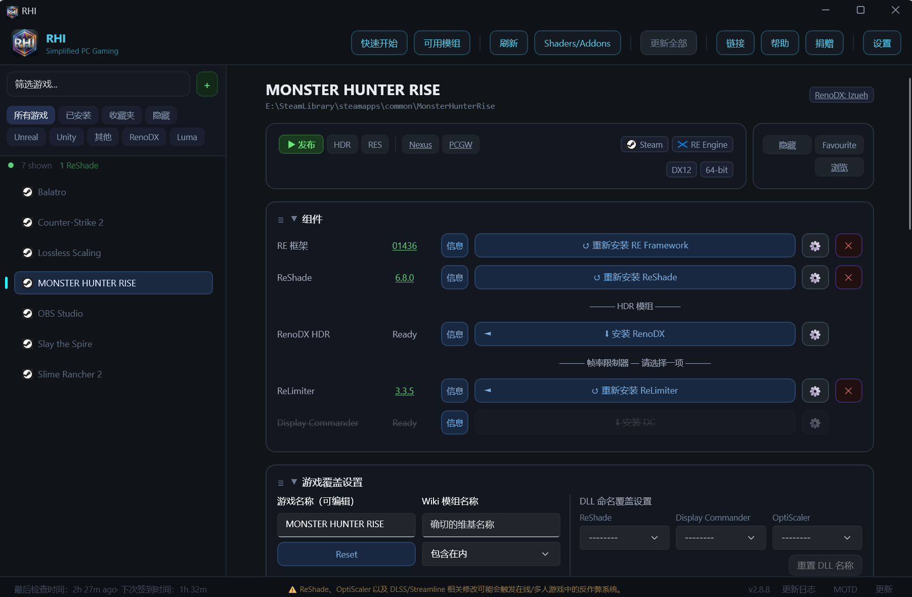

# RHI-chinese-version

**fork [RHI](https://github.com/RankFTW/RHI)**

**[📖 详细指南](docs/DETAILED_GUIDE.zh-CN.md)**

**easy to use DLSS 5**👊👊👊  
更适合中国宝宝体质的**RHI**  
基于原来的RHI，我为他添加了中文，同时下载组件可以走镜像站，加快下载。你也可以自己指定镜像站。

RHI有多强？
- 自动识别你游戏的渲染api （**超精准**）<(O_O)>
- 为你的游戏添加dlss5 **超便捷** <|(O o O)|>
- 用它添加dlss5没有坑，不折腾 **？！爽爽？！** ooooooooooooooOOOOOOO

## RHI — ReShade HDR Installer

**在一个窗口里，为你整个 PC 游戏库搞定 HDR mod、ReShade、DLSS 和 NVIDIA 驱动设置。**

RHI 能在八个商店平台中找出你的游戏，然后安装、更新和卸载 ReShade、RenoDX 与 Luma HDR mod、帧率限制器、DLSS/Streamline 文件、OptiScaler、Neural Rendering 工具等等，每一项都可按游戏单独控制。

> **仅限单人游戏。** 启用 addon 支持的 ReShade、OptiScaler 以及 DLSS/Streamline 改动，可能会在联网游戏中触发反作弊。游玩多人模式前请先卸载。

---

#### 为每款游戏带来 HDR

- **[RenoDX](https://github.com/clshortfuse/renodx)**：为每款游戏找到并安装合适的 HDR mod，并持续保持更新。没有专属 mod 的游戏会装上一个通用版本：
  - **Unreal Engine 4/5**：UE-Extended，并替你配置好 `reshade.ini` 和 `Engine.ini`。
  - **Unity**：通用 Unity addon（32 位与 64 位）。
- **[Luma Framework](https://github.com/Filoppi/Luma-Framework)**：具名的 Luma mod，外加适用于 DX11 版 Unreal Engine 游戏的通用 Luma。安装时会应用 Luma wiki 中的 Engine.ini 键值、启动参数和 TAA 设置。DX9 的 Luma 游戏会自动配上 dgVoodoo2。
- **RTX HDR 与 Windows Auto HDR**：可在 RenoDX ⚙ 菜单里按游戏启用其中任意一项。RTX HDR 设置（峰值亮度、对比度、饱和度、中灰、去色带）会直接写入该游戏的 NVIDIA 配置档。
- **[DXVK + Lilium HDR](https://github.com/EndlesslyFlowering/dxvk)**：为 DX8–DX11 游戏提供 scRGB HDR，并附带从「最安全」到「实验性」的多档预设。
- **DOF Fix**：推荐用于 Unreal Engine 5.0–5.6 的游戏。
- **可用 Mod**：一份可搜索的完整列表，涵盖所有拥有 RenoDX、Luma 或 Ultra+ mod 的游戏。

#### ReShade，全托管

RHI 取代了 ReShade 安装器。

- 依据游戏的图形 API 与位数自动选择正确的 DLL 名称（`dxgi.dll`、`d3d9.dll`、`d3d8.dll`、`opengl32.dll`），也可为每款游戏自定义名称。
- 按游戏可选通道：**Stable**、**Nightly**、**Custom**（使用你自己的 DLL）、**No Addons** 以及 **Legacy**（挑选旧版本）。
- Vulkan 游戏使用 ReShade 的全局 Vulkan 层。
- 覆盖其他工具的 DLL 之前会先警告（DXVK、Special K、ENB），并对被替换的文件做备份。
- 自动维护 `reshade.ini`：热键、截图目录、峰值亮度和效果列表风格，可应用到单款游戏或全部游戏。锁定某款游戏的 ini 即可让 RHI 不再改动它。
- **56 个着色器包**（Lilium HDR、crosire、PumboAutoHDR、MaxG2D、RenoFX、UltraShade、iMMERSE、qUINT、SweetFX 等等）。可全局或按游戏挑选着色器包，也可挑选单个 `.fx` 文件。选择可保存为配置档，并以 zip 分享。
- **Addon 管理器**：官方 ReShade addon 列表外加额外项目，可全局或按游戏启用，也支持你自己的 `.addon64`/`.addon32` 文件。
- **ReShade 预设**：把预设连同其所需的着色器一起部署到任意游戏。

#### DLSS 与 Streamline

- 在下拉菜单中按游戏切换 **Super Resolution、Ray Reconstruction、Frame Generation、Neural Rendering** 与 **Streamline** 的版本。原文件会被备份，随时可以还原。
- 在 NVIDIA 驱动配置档中设置**预设**（包括 DLSS 4.5 的 transformer 预设 L 和 M）与**渲染缩放**（33–100%，或 DLAA）。不再需要 NVIDIA Profile Inspector。
- **NVIDIA Override**：按组件开启驱动的「使用最新 DLL」覆盖选项。
- **默认值 + 快速应用**：先一次性选定你偏好的版本与预设，之后一键应用到任意游戏。
- **批量部署**：把版本与预设一次性推送到多款游戏。
- **自动更新**：可选择在新版 DLSS 或 Streamline 发布后，立即把游戏升级过去。

#### Neural Rendering（DLSS 5）

每款游戏的页面都有 Neural Rendering 区块，可安装四种方法之一，并会为游戏推荐合适的那一种：

- **ShortFuse DLSS Tool**：适用于大多数原生支持 DLSS 的游戏（DX9、DX11、DX12、Vulkan）。
- **DLSS5 Tool**：适用于原生支持 DLSS 的 DX12 游戏。
- **DLSS5 Tool + DX11 Bridge**：适用于原生支持 DLSS 的 DX11 与 Vulkan 游戏。
- **DLSS5 Feeder**：适用于没有 DLSS 的游戏，包括 OpenGL、DX9 与 32 位游戏。

可以锁定各工具以及 `nvngx_dlssnr.dll` 的版本，还可选择加上 **NR Cost Scaler**，以更低的开销运行神经模型。

#### 帧生成与超分辨率增强

- **[OptiScaler](https://github.com/optiscaler/OptiScaler)**：提供 Stable、Nightly（支持锁定构建）、DLSS NR 与 F5 DLSSNR 变体。超分辨率、帧生成、Reflex、预设与 Neural Rendering 设置全都在一个菜单里完成，并替你写好 `OptiScaler.ini`。针对 NVIDIA、AMD 和 Intel 提供不同的 GPU 专用 ini 模板。内含 OptiPatcher。
- **多帧生成**：在 RTX 50 系列上设置固定或动态 MFG（2 倍–6 倍）以及目标帧率。
- **旧显卡的 MFG 解锁**：RTX 40 MFG、MFG Ada Unlock、20/30 FG Unlock、RTX Encore（beta）以及 DLSS Enabler。
- **[Ultimate ASI Loader](https://github.com/ThirteenAG/Ultimate-ASI-Loader)** 与 **[dgVoodoo2](https://github.com/dege-diosg/dgVoodoo2)**，带文件名选择器。

#### 帧率限制器

每款游戏选一个：

- **[ReLimiter](https://github.com/RankFTW/ReLimiter)**：帧节奏限制器，带屏幕内显示、VRR 上限和 DLSS 挂钩。
- **[Display Commander](https://github.com/pmnoxx/display-commander)**：另一款限制器，附带显示相关工具。

两者都支持 32 位与 64 位游戏，且安装任意一款都会关闭该游戏的驱动帧率限制器。

#### NVIDIA 驱动设置

直接写入驱动，因此无需 NVIDIA App 或 Profile Inspector。

- **按游戏**：VSync、Tear Control、Low Latency、Smooth Motion（RTX 40+）、电源模式、G-Sync、ReBAR（启用、模式与大小）。
- **全局**：着色器缓存大小与预编译、G-Sync 与 G-Sync 模式、FPS 上限、首选刷新率、VSync、电源模式、ReBAR。
- **Digital Vibrance** 按显示器设置，每次 RHI 启动时重新应用。
- **DLDSR Control**：无需打开 NVIDIA 控制面板，即可保存并切换 DLDSR 倍率方案。
- **备份与还原**你的按游戏配置档，例如重装驱动之后。
- **输出色彩**：按显示器设置色深（8/10/12 bpc）与动态范围。

#### 日常便利功能

- **全部更新**：在你的游戏库范围内更新 ReShade、RenoDX、ReLimiter、Display Commander、OptiScaler、RE Framework、DXVK、Luma 与 DOF Fix。包含哪些由你决定，可全局也可按游戏。**自动更新**可在后台完成安装。
- **启动游戏**：可从 RHI、系统托盘、任务栏跳转列表或桌面快捷方式启动。可按游戏自定义 exe 与启动参数。
- **HDR 与分辨率自动切换**：游戏启动时开启 Windows HDR 并切换分辨率，退出时再一并切回。可全局或按游戏设置，并指定作用于哪些显示器。
- **拖放**：把游戏 exe、addon、压缩包、Luma mod、ReShade 预设或链接直接拖到窗口上。
- **按游戏的链接**：Nexus Mods、PCGamingWiki、超宽屏修复与 Ultra+。
- **RE Framework** 支持 RE Engine 游戏，支持 **Ryubing** 模拟器，并提供**自定义游戏过滤器**。
- **远程清单**：新的游戏支持与修复无需等待应用更新即可送达所有用户。

---

#### 支持的商店

Steam · Epic Games · GOG · EA App · Ubisoft Connect · Xbox / Game Pass · Battle.net · Rockstar

没被检测到？点击搜索框旁的 **+**，或把游戏的 `.exe` 拖到窗口上。

#### 系统需求

- Windows 10 或 11（64 位）
- [.NET 8 Desktop Runtime](https://dotnet.microsoft.com/download/dotnet/8.0)。缺少 Windows App Runtime 时，安装程序会自动补上。
- 若要使用 DLSS 预设、驱动与 Neural Rendering 相关功能，需要 NVIDIA 显卡。ReShade、RenoDX、Luma 与 OptiScaler 在任何显卡上都能用。
- **管理员模式**（设置 → 常规 → 管理员模式）：用于按游戏的驱动设置、ReBAR、DLDSR Control 以及 DLSS 屏幕指示器。
- **建议配置 GitHub token。** 没有 token 时，GitHub 每小时只允许 60 次请求，可能导致下载和更新检查失败。可在 设置 → 账户与数据 → GitHub token 中添加一个无任何权限的免费 token，把上限提升到 5,000 次。

---

#### 第三方组件

RHI 会从这些组件的官方来源下载它们。所有功劳归于各自的作者。

| 组件 | 作者 |
|---|---|
| [ReShade](https://reshade.me) | crosire |
| [RenoDX](https://github.com/clshortfuse/renodx) | clshortfuse & contributors |
| [RenoDX UE-Extended](https://github.com/marat569/renodx) | Marat |
| [RenoDX Unity](https://github.com/NotVoosh/renodx-unity) | NotVoosh |
| [Luma Framework](https://github.com/Filoppi/Luma-Framework) | Pumbo (Filoppi) & contributors |
| [ReLimiter](https://github.com/RankFTW/ReLimiter) | RankFTW |
| [Display Commander](https://github.com/pmnoxx/display-commander) | pmnoxx |
| [RE Framework](https://github.com/praydog/REFramework-nightly) | praydog |
| [OptiScaler](https://github.com/optiscaler/OptiScaler) | OptiScaler contributors |
| [OptiScaler DLSS NR fork](https://github.com/wilsjo2/OptiScaler-DLSSNR-PreSR-Multipass) | wilsjo2 |
| [OptiScaler F5 DLSSNR fork](https://github.com/janblade/OptiScaler-F5-DLSSNR-Multipass) | janblade |
| [DXVK](https://github.com/doitsujin/dxvk) | doitsujin & contributors |
| [DXVK HDR-mod](https://github.com/EndlesslyFlowering/dxvk) | EndlesslyFlowering (Lilium) |
| [dgVoodoo2](https://github.com/dege-diosg/dgVoodoo2) | Dege |
| [Ultimate ASI Loader](https://github.com/ThirteenAG/Ultimate-ASI-Loader) | ThirteenAG |
| [DLSS5 Feeder](https://github.com/jlrouzies-fr/DLSS5-Feeder) | jlrouzies-fr |
| [DLSS5 DX11 Bridge](https://github.com/NIGos/dlss5-bridge) | NIGos |
| [RTX 40 MFG Unlock](https://github.com/dashdogy/RTX40MFG-Unlock) | dashdogy |
| [MFG Ada Unlock](https://github.com/mavismmg/MFGAdaUnlock-RenoDx) | mavismmg |
| [20/30 FG Unlock](https://github.com/sdli1995/dlssg_for_sm86) | sdli1995 |
| [RTX Encore](https://github.com/SilyNoMeta/rtx-encore) | SilyNoMeta |
| [7-Zip](https://www.7-zip.org/) | Igor Pavlov |

着色器包均为各自作者的成果；每个包在着色器选择器中都附有来源链接。游戏数据来自 [PCGamingWiki](https://www.pcgamingwiki.com) 和 [HDR Gaming Database](https://github.com/KoKlusz/HDR-Gaming-Database)。
