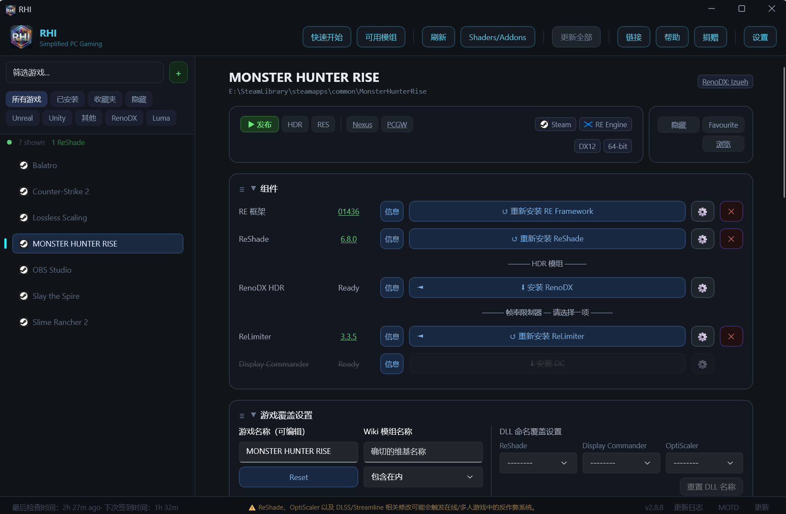

# RHI — 详细指南

本指南涵盖 RHI（ReShade HDR Installer）的全部功能。想看简要概览，请参阅 [README](../README.md)。需要帮助，欢迎加入 [Discord](https://discord.gg/ultraplace)。

> **仅限单人游戏。** 启用 addon 支持的 ReShade、OptiScaler 以及 DLSS/Streamline 改动，可能会在联网游戏中触发反作弊。游玩多人模式前请先卸载。

---

## 目录

1. [快速上手](#getting-started)
2. [主窗口](#the-main-window)
3. [游戏检测](#game-detection)
4. [组件](#components)
5. [ReShade](#reshade)
6. [RenoDX](#renodx)
7. [RTX HDR 与 Auto HDR](#rtx-hdr-and-auto-hdr)
8. [Luma Framework](#luma-framework)
9. [RE Framework](#re-framework)
10. [DOF Fix](#dof-fix)
11. [帧率限制器](#frame-limiters)
12. [着色器包](#shader-packs)
13. [ReShade Addon](#reshade-addons)
14. [ReShade 预设](#reshade-presets)
15. [DLSS / Streamline](#dlss--streamline)
16. [Neural Rendering（DLSS 5）](#neural-rendering-dlss-5)
17. [驱动设置与多帧生成](#driver-settings-and-multi-frame-generation)
18. [附加项](#extras)
19. [OptiScaler](#optiscaler)
20. [DXVK 与 dgVoodoo2](#dxvk-and-dgvoodoo2)
21. [游戏级覆盖设置](#game-overrides)
22. [管理](#management)
23. [启动游戏](#launching-games)
24. [设置页面](#settings-page)
25. [更新](#updates)
26. [拖放与 Addon 检测](#drag-and-drop-and-addon-detection)
27. [Vulkan 游戏与 Ryubing](#vulkan-games-and-ryubing)
28. [链接：Nexus、PCGamingWiki、UW Fix、Ultra+](#links-nexus-pcgamingwiki-uw-fix-ultra)
29. [远程数据](#remote-data)
30. [数据存储与日志](#data-storage-and-logs)
31. [疑难排查](#troubleshooting)
32. [第三方组件](#third-party-components)

---

## 快速上手

### 系统需求

- Windows 10 或 11（64 位）。
- [.NET 8 Desktop Runtime](https://dotnet.microsoft.com/download/dotnet/8.0)。若缺少 Windows App Runtime，安装程序也会一并装上。
- 若要使用 DLSS 预设、驱动设置与 Neural Rendering，需要 NVIDIA 显卡。ReShade、RenoDX、Luma 和 OptiScaler 在任何显卡上都能用。

### 首次启动

RHI 第一次启动时，会弹出 **Welcome to RHI**（欢迎使用 RHI）窗口，询问你希望如何处理 ReShade：

- **Manage ReShade for me**（替我管理 ReShade）：常规方案。由 RHI 负责安装、更新并配置 ReShade 与着色器。
- **I'll manage it myself**（我自己管理）：ReShade 会被排除在 Update All 之外，「Download all shaders」会被关闭，全局着色器设为 Off。这些之后都能在设置里修改。

随后 RHI 会扫描你的游戏库。之后每次启动会先显示缓存的游戏库，再在后台重新扫描。

### 添加 GitHub token（建议）

RHI 下载的东西大多来自 GitHub。没有 token 时，GitHub 每小时只允许 60 次请求，一旦用完，下载和更新检查就会失败，直到这一小时结束。有了 token，上限提升到 5,000 次。

1. 打开 [github.com/settings/tokens](https://github.com/settings/tokens)，创建一个 **classic** token。不用勾选任何选项，它不需要任何权限。
2. 在 RHI 中打开 **设置 → 账户与数据 → GitHub token**，粘贴 token（以 `ghp_` 或 `github_pat_` 开头），然后点击 **Save**。

RHI 会校验这个 token，把它存到 `%LOCALAPPDATA%\RHI\github_api.txt`，并立即开始使用，重启后依然有效。**Remove** 会删除它。该 token 只会发送到 `api.github.com`。界面上也有 **Sign in with GitHub instead**（改用 GitHub 登录）选项，但 token 更可靠，且已保存的 token 优先级高于登录方式。

### 快速上手引导

工具栏的 **Quick Start** 按钮会打开内置的引导流程，内容涵盖：选择游戏、安装 ReShade、RenoDX 与 Luma、着色器、DOF Fix、帧率限制器、DLSS/Streamline、OptiScaler、各项设置、NVIDIA 驱动设置、Vulkan 游戏、手动添加游戏、更新，以及 Full Refresh（完整刷新）。点击 **← Back to Games** 返回游戏库。

---

## 主窗口

RHI 只有一套布局：左侧是游戏列表，右侧是所选游戏的详情面板，顶部是工具栏，底部是状态栏。设置、关于和快速上手会以整页形式打开，并带有 **← Back to Games** 按钮。窗口会记住自身的大小、位置和最大化状态，最小宽度为 1220 像素。

### 工具栏

| 按钮 | 作用 |
|---|---|
| **New Mods Available** | 仅当自你上次查看以来出现了新的 RenoDX、Luma 或 Ultra+ mod 时才显示。会列出这些 mod；点击 **Dismiss** 可隐藏按钮，直到又有新 mod 出现。 |
| **Quick Start** | 打开内置的快速上手引导。 |
| **Available Mods** | 一份可搜索的列表，列出所有受支持的游戏，并带有 **RenoDX**、**Luma** 和 **Ultra+** 三列。✓ = 已完成，🔨 = 开发中，✗ = 无。点击对勾可打开对应 mod 的页面。在搜索词开头输入 `RenoDX`、`Luma` 或 `Ultra+` 可只显示该类型，后面还可跟名称（例如 `luma dead`）。列表也包含 RenoDX 的 Source addon 所支持的 Source 引擎游戏；RHI 会列出它们，但暂时还无法安装。mod 数据加载完成前此按钮不可用。 |
| **Refresh** | 重新扫描游戏库并获取最新的 mod 信息。 |
| **Shaders/Addons** | 包含 **Global Shaders**（着色器包选择器）与 **Global Addons**（ReShade addon 管理器）。 |
| **Update All** | 更新游戏库中已安装的组件。有可用更新时会高亮。详见[更新](#updates)。 |
| **Links** | RenoDX Wiki、Luma Wiki、RHI GitHub、ReLimiter GitHub。 |
| **Help** | Discord、本指南（本页）、Ko-fi、关于。 |
| **Donate** | “Support the Mod Authors”（支持 mod 作者）：列出 RHI 所安装作品的 mod 作者，每位作者都带一个 Ko-fi 按钮。 |
| **Settings** | 打开[设置页面](#settings-page)。 |

### 侧边栏

- **搜索框**（“Filter games...”）：按游戏名称、商店、引擎、图形 API、位数，以及 RenoDX 或 Luma 的 mod 名称与作者实时筛选。它也能识别诸如 `DLSS`、`Ray Reconstruction`、`Frame Generation`、`Streamline`、`RE Engine`、`RE Framework`、`32-bit`、`64-bit`、`UW Fix` 和 `Ultra+` 之类的关键词。
- 搜索框旁的 **+** 按钮：
  - 绿色的 **+**（**Manually add a game**，手动添加游戏）：详见[手动添加游戏](#adding-a-game-manually)。
  - 搜索时会多出第二个 **+**：**Save current search as a custom filter** 可把当前搜索保存为一个具名标签（类似青色的 DLSS、Vulkan 或 Xbox 标签）。点击标签可切换启用状态，右键可删除。
- **筛选标签**：**All Games**、**Installed**（已安装 ReShade 的游戏）、**Favourites** 和 **Hidden** 只能四选一。**Unreal**、**Unity**、**Other**、**RenoDX** 与 **Luma** 可进一步收窄范围并能叠加使用。被隐藏的游戏只会出现在 Hidden 下。你选择的筛选会被记住。
- 一行计数信息：显示的游戏数、已装 ReShade 的游戏数、隐藏的游戏数。
- 每行游戏都会显示商店图标与名称；当其任一组件有更新时显示**绿点**（被排除在 Update All 之外的除外）；通过 RHI 启动的游戏运行期间，该行会变成**绿色**。
- **双击**游戏可启动它。**右键**可打开文件夹、收藏、隐藏/显示、Discussion / Instructions、View Notes（可用时），以及 **Create Desktop Shortcut**（创建桌面快捷方式）。

### 详情面板

**头部**

- 游戏名称与安装路径，并带有 mod 作者徽标（已知时可点击打开其 Ko-fi 页面）。
- **▶ Launch**，随后是 **HDR** 与 **RES**（按游戏设置的 HDR 与分辨率自动切换；紫色表示已开启）。
- **Nexus**、**PCGW**、**UW Fix** 与 **Ultra+** 链接按钮，仅当该游戏存在对应页面时才显示。
- 商店与引擎徽标。对于 Unreal 版本不明确的游戏，点击引擎徽标可在“Unreal Engine”与“Unreal Engine 5”之间切换（这决定了是否符合 [DOF Fix](#dof-fix) 的安装条件）。
- 已安装的 RenoDX/Luma addon 名称，带 ✓（已完成）或 🔨（开发中）状态图标、wiki 状态、图形 API 徽标以及 32 位/64 位徽标。
- **Hide/Show**、**Favourite**、**Config**（打开该游戏的配置文件夹，仅当 RHI 能找到时显示）以及 **Browse**（打开游戏文件夹）。

**区块**

头部下方共有七个区块：

1. **Components**：ReShade、HDR mod、DOF Fix 与帧率限制器。
2. **Game Overrides**：按游戏的各项设置。
3. **Neural Rendering**：DLSS 5 工具。
4. **DLSS / Streamline**：DLSS 版本、预设与渲染缩放。
5. **Driver Settings**：按游戏的 NVIDIA 驱动设置。
6. **Management**：安装目录、重置与报告工具。
7. **Extras**：ASI Loader、OptiScaler、帧生成解锁、DXVK 与 dgVoodoo2。

点击区块标题即可折叠或展开。拖动 **≡** 手柄可重新排序区块。折叠后的区块会显示一行摘要，例如已安装的版本或当前生效的覆盖项。顺序、折叠状态与摘要都会被记住。

### 状态栏

- **左侧**：RHI 当前正在做什么。
- **中间**：反作弊提醒。
- **右侧**：
  - **版本号**。点击可检查应用更新。
  - **Patch Notes**（更新日志）。
  - **MOTD**：再次显示当前的每日消息。
  - **Updates**：按日期记录每一次组件更新的历史，显示旧版本 → 新版本。记录会在多次会话之间保留，也可以清空。

---

## 游戏检测

### 支持的商店

| 商店 | 检测方式 |
|---|---|
| Steam | 每个库文件夹中的 `libraryfolders.vdf` 与应用清单 |
| Epic Games | 经典启动器的清单，以及新版 Epic Games Launcher 的安装列表 |
| GOG | 注册表 |
| EA App | 安装记录 |
| Ubisoft Connect | 注册表与安装文件夹。育碧游戏使用其文件夹名（例如 `Watch_Dogs2`） |
| Xbox / Game Pass | 已安装的包 |
| Battle.net | 安装记录 |
| Rockstar | 安装记录 |

每次启动都会先显示缓存的游戏库，然后重新扫描各商店并合并新游戏。在扫描中消失的游戏（例如位于已拔出的硬盘上）仍会留在列表里。若某个商店扫描失败，其他商店仍会照常扫描。

### 引擎检测

RHI 通过游戏的文件来识别引擎：

- **Unreal Engine**：依据 UE4/UE5 的文件夹结构，并尽可能从游戏文件中读出具体版本。UE1–3 的游戏会显示为 **Unreal (Legacy)**。
- **Unity**：`UnityPlayer.dll` 与 Unity 数据文件夹。
- **RE Engine**：RE Engine 数据文件。
- **Other**：其他所有情况。此时 RHI 会借助 PCGamingWiki 数据或远程清单来标注引擎（例如 Frostbite、REDengine、Source）。

引擎未知的游戏不会在每次启动时完整重扫，只在文件夹变化或执行 Full Refresh 时才重扫。

### 图形 API 检测

RHI 会读取每个游戏可执行文件的导入表，以确定其图形 API 与位数。徽标包括：**DX8**、**DX9**、**DX10**、**DX11**、**DX12**、**VLK**（Vulkan）与 **OGL**（OpenGL）；当游戏使用多种 API 时会组合显示（例如 `DX11/12`、`DX11/12 / VLK`）。Unity 游戏则从 `boot.config` 读取。若可执行文件无法读取（Game Pass、受保护文件夹），RHI 会改用 PCGamingWiki 数据。远程清单与你自行设置的 **Graphics API** 覆盖始终优先。

API 决定了 ReShade 的 DLL 名称、是否提供 DXVK 与通用 Luma，以及可用的 Neural Rendering 方法。

### 手动添加游戏

- 点击搜索框旁的 **+**（Manually add a game），选择游戏的 `.exe`，为它起个名字，然后点击 **Add Game**。也可以直接把 `.exe` 拖到窗口上。
- 手动添加的游戏，商店显示为 **Manual**。
- 要移除它，请使用 **Management → Reset / Remove game**。

### 重命名、隐藏与收藏

- **重命名**：Game Overrides → **Game name (editable)**，然后按回车。**Reset** 可恢复为检测到的名称。你的设置会随游戏一起迁移。
- **隐藏**与**收藏**：头部按钮或右键菜单。按游戏和商店分别保存。
- 某些包含多款游戏的文件夹（合集）会被远程清单拆分为独立条目。

---

## 组件

**Components** 区块按以下顺序列出：

- **RE Framework**（仅 RE Engine 游戏）。
- **ReShade**。
- **HDR Mods**：**RenoDX HDR** 与 **Luma**（当存在 Luma mod 时）。
- **Recommended**（推荐）：**DOF Fix**（符合条件的 Unreal Engine 5 游戏）。
- **Frame limiters — Choose one**（帧率限制器 — 二选一）：**ReLimiter** 与 **Display Commander**。

OptiScaler、DXVK 与帧生成工具位于[附加项](#extras)区块。

### 行内控件

每一行都有一个状态/版本标签、**Info**、安装按钮、**⚙**（设置）与 **✕**（卸载）。

- **状态**：已安装时显示为绿色并带下划线（点击可打开发布页面）；有可用更新时显示紫色的 **Update**；未安装时显示 **Ready**。
- **安装按钮**：显示为 **Install**、**Reinstall**、**Update**（紫色）、**Installing...**，或 **⚠ ReShade required**。
- **Info**：当本游戏有相关信息时显示为蓝色，没有时置灰。若安装按钮上有个 **◄**，表示 Info 中含有值得先读的游戏专属说明。

### 依赖关系

- RenoDX、Luma、ReLimiter、Display Commander 与 DOF Fix 都需要 ReShade。若你已把该游戏的 ReShade 排除在 Update All 之外（例如你自己管理 ReShade），这一步会被跳过。
- 在 RE Engine 游戏上，必须先安装 RE Framework，再安装 ReShade。
- ReLimiter 与 Display Commander 不能同时安装。
- 使用 **No Addons** 版 ReShade 通道时，RenoDX、ReLimiter 与 Display Commander 均不可用。

---

## ReShade

### 文件来源

RHI 从 reshade.me 下载带 addon 支持的 ReShade，Nightly 版本则取自 ReShade 的 GitHub builds。两者都会缓存，因此安装几乎是瞬间完成。

### DLL 名称

RHI 会依据游戏的 API 与位数来命名 ReShade 的 DLL：

| 游戏 API | ReShade 文件 |
|---|---|
| DX10 / DX11 / DX12 | `dxgi.dll` |
| DX9 | `d3d9.dll` |
| DX8 | `d3d8.dll` |
| OpenGL | `opengl32.dll` |
| Vulkan | 全局 Vulkan 层（参见 [Vulkan 游戏](#vulkan-games-and-ryubing)） |

若要使用其他名称，可在 Game Overrides → **DLL naming overrides → ReShade** 中选择。如果 OptiScaler 或 Display Commander 已经占用了 ReShade 的名称，RHI 会把 ReShade 装成 `ReShade64.dll`/`ReShade32.dll`，以便它们能加载它。

### ReShade 通道

在 Game Overrides → **ReShade Channel** 中按游戏设置：

| 通道 | 作用 |
|---|---|
| **Stable**（默认） | 带 addon 支持的最新正式版。 |
| **Nightly** | 最新的开发构建。仅在内容变化时重新下载。 |
| **Custom** | 使用你自己的 ReShade DLL。把它放进 `%LOCALAPPDATA%\RHI\Custom\ReShade\`，然后在「Select Custom ReShade」对话框中选择。若你替换了该文件，RHI 会在下次刷新或更新检查时重新部署它。 |
| **No Addons** | 不支持 addon 的标准版 ReShade。切换后会移除带 addon 的 ReShade、RenoDX、ReLimiter 与 Display Commander。着色器仍然可用。 |
| **Legacy...** | 选择一个旧版本。Legacy 游戏会被排除在 ReShade 更新之外。 |

在 Vulkan 游戏上，切换通道会在你确认后应用于所有 Vulkan 游戏（它们共用同一个层）。

### ReShade ⚙ 设置

当游戏已有 `reshade.ini` 后才可用：

- **Deploy ReShade.ini**：把 RHI 的模板合并进游戏的 ini。模板键会覆盖同名键；仅存在于游戏 ini 中的键会被保留。从而应用你的热键、截图目录与峰值亮度。
- **Deploy ReShadePreset.ini**：把 `%LOCALAPPDATA%\RHI\inis\ReShadePreset.ini` 复制到游戏中。
- **Open ReShade.ini**、**Open ReShade.log**、**Copy ReShade.log to clipboard**。
- 该游戏的 **Overlay Key** 与 **Screenshot Key**。
- **Keep ReShade.ini Updated**（Yes/No）：设为 **No** 后，RHI 在安装、更新以及任何「Write ... to all games」操作中都绝不会改动该游戏的 `reshade.ini`。

`reshade.ini` 模板位于 `%LOCALAPPDATA%\RHI\inis\`。你可以自由编辑它，RHI 不会覆盖你的修改。

### 全局 ReShade 设置

在 **设置 → ReShade & RenoDX → Keys, screenshots and brightness** 中：

- **Keys and screenshots**（热键与截图）：Overlay key、Screenshot key、截图目录（**Folder per game** 会为每款游戏建立独立子文件夹）、效果列表样式（Tabs/Tree），以及 **Write these to all games**。
- **HDR brightness (RenoDX)**：显示器的峰值亮度，单位为 nits（可手动输入或点击 **Auto**）。每次安装、更新和部署 ini 时，都会以 `ToneMapPeakNits` 写入 RenoDX 预设。其 ⚙ 可设定是否自动执行，以及写入哪些预设（1、2、3）。**Write peak brightness to all games** 会立即写入全部游戏。

「Write ... to all games」系列按钮会跳过已隐藏的游戏，以及 **Keep ReShade.ini Updated** 设为 No 的游戏。

### 外部 DLL 保护

如果游戏文件夹里已经存在一个不是 ReShade 的 `dxgi.dll`（或其他 ReShade 名称），例如 DXVK、Special K 或 ENB，RHI 会先警告你并征得同意再覆盖。它确实覆盖掉的任何文件都会事先备份。

### Game Pass 游戏

RHI 无法写入 `C:\Program Files\WindowsApps\` 内部。对于安装在别处的 Game Pass 游戏，如果游戏更新把它移到了新的版本号文件夹，RHI 会自动在那里重装 ReShade。

---

## RenoDX

[RenoDX](https://github.com/clshortfuse/renodx) mod 会替换游戏的色调映射，从而实现真正的 HDR 输出。它们以 ReShade addon 的形式加载。

### mod 数据来源

默认情况下，RHI 使用 **RHI Database**：一份经过整理的清单，包含具名 mod、UE-Extended 游戏、Unity 游戏与 Source 引擎游戏。你也可以在 设置 → 账户与数据 → **Mod data source** 中切换到 **RenoDX Wiki**。

### mod 的匹配方式

RHI 按名称匹配每款游戏（忽略 ™ 与 ® 符号）。若匹配错误或没有匹配，请在 Game Overrides 中设置 **Wiki mod name**。若要彻底阻止某款游戏参与匹配，请把 **Wiki lookup** 设为 **Excluded**。

没有具名 mod 时：

| 游戏 | 回退方案 |
|---|---|
| Unreal Engine 4/5 | **UE Extended**（Marat 的 addon）。原生支持 HDR 的游戏会使用 **UE Extended Native HDR**。 |
| Unity | **Generic Unity**（NotVoosh 的 addon，32 位与 64 位）。RHI 还会从数据库中写入按游戏的设置。 |

部分 mod 托管在 GitHub 之外。这类 mod 的按钮会显示为 **Download from Nexus**（或 Discord），点击即打开对应页面。托管在 Nexus 上的 mod 仍会检查更新。

已安装 addon 名称旁的 ✓ 或 🔨 表示该 mod 是已完成还是仍在开发中。

### RenoDX ⚙ 设置

- **UE-Extended Settings**（Unreal 游戏）：
  - **UE-Extended**（Off/On）：在 UE-Extended 与通用 UE addon 之间切换。
  - **Set Maximum Nits**（含 **Auto**）：仅针对本游戏设置峰值亮度。
  - **Upgrade Path**（升级路径）。
  - **Engine.ini HDR**（Off/On）：为没有游戏内 HDR 选项的游戏写入 Engine.ini 的 HDR 设置。若想跑 SDR，请关闭它。
  - **LUT Update Every Frame**（Off/On）。
- **Compatibility Settings**：以下拉菜单形式列出本游戏 `reshade.ini` 中的 RenoDX 兼容性键（swapchain proxy、encoding、resource upgrades 等）。先带 RenoDX 运行一次游戏，这些键才会生成。
- **RenoDX Presets**：**Export Presets** 会把本游戏的 RenoDX 预设保存为游戏目录下的 `RHI-RenoDX-Preset.txt`，并复制到剪贴板。**Import Presets** 可将其还原。
- **RTX HDR** 与 **Auto HDR**：详见[下文](#rtx-hdr-and-auto-hdr)。

### UE-Extended 自动配置

安装 UE-Extended 时，RHI 会：

- 把所需的 `[renodx]` 键写入 `reshade.ini`（仅补充缺失的键，你已有的会被保留）。
- 把 HDR 相关键写入游戏配置文件夹中的 `Engine.ini`，并将该文件设为只读，以免游戏覆盖它。部分游戏则改用清单提供的自定义 Engine.ini。

关闭 UE-Extended 会撤销这些改动。

---

## RTX HDR 与 Auto HDR

两者都是 RenoDX mod 的替代方案，因此启用其中任意一项都会**卸载该游戏的 RenoDX**。同一时间只能启用其中之一。两者都在 RenoDX 的 ⚙ 菜单中。

### RTX HDR

NVIDIA 在驱动层面提供的 SDR 转 HDR 功能。它需要 NVIDIA RTX 显卡，以及启用了覆盖层和 Game Filters 的 NVIDIA App。

- **Enable RTX HDR** 会把初始数值写入该游戏的 NVIDIA 配置档：峰值亮度取自你的全局 Peak brightness，Contrast +25（gamma 2.2），Saturation −25，middle grey 为 Auto。
- 安装按钮会变成 **Configure RTX HDR**，点击打开 **RTX HDR Settings**：
  - **Peak Brightness**：400–2000 nits。
  - **Contrast**：−100 至 +100，并提供 Gamma 2.0 / 2.2 / 2.4 快捷选项。
  - **Middle Grey**：10–100，或 Auto。
  - **Saturation**：−100 至 +100。
  - **Debanding**：No / Low / High，另有指示器模式。修改此项需要管理员权限。
  - **Save as Default** / **Set Default**。
- 关闭 RTX HDR 会把它写入配置档的所有设置移除。

### Auto HDR

Windows 11 的 Auto HDR，通过注册表为这款游戏强制开启。它在任何显卡上都能用，即使 Windows 的全局 Auto HDR 处于关闭状态也一样。

- **Enable Auto HDR**。随后安装按钮会变成 **Configure Auto HDR**，带一个亮度滑块，从 0（不增强）、50（默认）到 100（约 1000 nits）。
- 改动会在游戏下次启动时生效。

---

## Luma Framework

[Luma](https://github.com/Filoppi/Luma-Framework) mod 会为 HDR 重建游戏的渲染流程，通常还会顺带加入 DLSS 支持。

### 哪些游戏能用 Luma

- **具名 mod**：来自 Luma wiki、GitHub releases 与 Nexus Mods。仅托管在 Nexus 的 mod 会显示 **Get on Nexus Mods**，并会检查更新。
- **通用 Luma**：用于 DX11 的 Unreal Engine 游戏（含 Legacy Unreal）。UE5 游戏只有在把其 Graphics API 覆盖设为 DX11 时才会提供。被 Luma wiki 标记为不兼容的游戏会被跳过。

### 安装

点击 **Install Luma**（必须先装好 ReShade）。RHI 会：

1. 把 mod 解压到游戏文件夹。
2. 部署其中最新的 `nvngx_dlss.dll`（并备份游戏原有的那个）。
3. 为 Luma 配置好 ReShade 与 `reshade.ini`。
4. 在需要的 DX9 游戏上安装 dgVoodoo2。
5. 对于通用 Luma：应用 Luma wiki 中的 Engine.ini 键值与启动参数（对于同时支持 DX11 和 DX12 的游戏则用 `-dx11`），并应用 TAA 设置。

版本会显示为 **Build N**。通过拖入压缩包方式安装的 Luma mod 无法自动重装：请再次把压缩包拖到窗口上。

### Luma ⚙ 设置（Unreal 游戏）

- **HDR on First Boot**（Default/Off/On）。
- **TAA Settings**（Off/On）。

### Luma 与 RenoDX 共存

通常一款游戏只会使用 Luma 或 RenoDX 其中之一。通用 Luma 游戏，以及被清单标记为兼容的游戏，可以两者同时使用。

### 卸载

卸载 Luma 会删除其文件、还原原始的 `nvngx_dlss.dll`、重置 `reshade.ini`，并移除它添加的启动参数与 Engine.ini 键。ReShade 与你的着色器会保持安装状态。

---

## RE Framework

对于 RE Engine 游戏（如《生化危机》《怪物猎人》《鬼泣》《街头霸王 6》等），[RE Framework](https://github.com/praydog/REFramework-nightly) 会以 `dinput8.dll` 形式安装，且必须先于 ReShade 安装。RHI 会下载 nightly 构建并保持更新。

在某些已安装 OptiScaler 的游戏上，清单会把 RE Framework 切换为 PD-Upscaler 构建。

**⚙ RE Framework Settings → Delete _storage_ folder** 会清除 RE Framework 为该游戏保存的数据。

---

## DOF Fix

用于修复 Unreal Engine 5.0–5.6 游戏景深（depth of field）问题的方案。它会作为 **Recommended** 出现在 64 位 UE 5.0–5.6 游戏以及清单额外指定的游戏的 Components 中。它依赖 ReShade，并包含在 Update All 中。**Info** 会显示其发布说明。

如果某款游戏的引擎徽标只写着“Unreal Engine”，点击徽标把它标记为 Unreal Engine 5，即可让 DOF Fix 变得可用。

---

## 帧率限制器

**Frame limiters — Choose one** 下有两款基于 ReShade addon 的帧率限制器，每款游戏可任选其一安装。两者都：

- 需要 ReShade，并且在 No Addons 通道下不可用；
- 支持 32 位与 64 位游戏；
- 会自动更新，并包含在 Update All 中；
- 安装后会关闭该游戏的 NVIDIA 驱动帧率限制器（卸载后恢复全局设置）。

### ReLimiter

[ReLimiter](https://github.com/RankFTW/ReLimiter) 是一款带屏幕内显示的帧节奏限制器。

- 安装该 addon 以及 `relimiter.ini`（若游戏没有，则使用 RHI 的模板）。
- **设置 → 组件 → ReLimiter**：OSD 热键、**Shared Presets**（所有游戏共用一份 OSD 预设文件）、**DLSS Hooks**（在 OSD 上显示 DLSS 信息；若某游戏会崩溃请关闭）、**Target FPS**（VRR 上限，从 60 Hz 下的 59 FPS 直到 500 Hz 下的 431 FPS，或自定义 20–1000），以及 **Write to all ReLimiter games**。
- **⚙ ReLimiter Settings**：部署 relimiter.ini，打开或复制 ReLimiter 日志，以及按游戏的 **Target FPS** 与 **DLSS Hooks**。

### Display Commander

[Display Commander](https://github.com/pmnoxx/display-commander) 是一款附带显示工具的备选限制器。它以 `zzz_display_commander.addon64`/`.addon32`（或 DLL naming overrides 中设定的名称）连同 `DisplayCommander.ini` 一起安装。**⚙ → Deploy DisplayCommander.ini** 会用 RHI 的模板重置它的 ini。

---

## 着色器包

RHI 管理 56 个 ReShade 着色器包。其中 50 个内置，远程清单还可以在不更新应用的情况下新增、更新或停用着色器包。

| 类别 | 着色器包 |
|---|---|
| **Essential**（必备） | Lilium HDR Shaders（多数 HDR 工具都依赖它） |
| **Recommended**（推荐） | crosire reshade-shaders、PumboAutoHDR、MaxG2D Simple HDR Shaders、clshortfuse ReShade shaders、RenoFX HDR Toolkit、UltraShade |
| **Extra**（额外） | 其余全部，包括 iMMERSE、qUINT、METEOR、SweetFX、OtisFX、prod80、CorgiFX、ZenteonFX、CShade、CRT-Royale、VRToolkit、GShade-Shaders、QD-OLED APL Fixer、LumaBoost、Glamarye Fast Effects、smolbbsoop、potatoFX 等等 |

### 全局着色器模式

**设置 → ReShade & RenoDX → Shaders and addons → Shaders**：

- **RHI Managed**：RHI 会把所选着色器包部署到每款游戏。
- **Custom**：RHI 只部署你自己的着色器。
- **Off**：除非某款游戏有自己的覆盖设置，否则 RHI 不部署着色器。

**Download all shaders**（默认开启）会在启动时下载全部着色器包，让安装瞬间完成。关闭后只在需要时才下载相关包。

### 选择着色器包

工具栏 **Shaders/Addons → Global Shaders** 会打开 **Select Shader Packs**：

- 可搜索着色器包与单个着色器。
- 可勾选整个包，或展开后勾选单个 `.fx` 文件。部分勾选的包会显示半选复选框。某个包所依赖的着色器会自动被勾选。
- **Expand All**、**Collapse All**、**Deselect All**。
- **Custom Shaders** 区块会列出你自己的文件。
- **Deploy** 会保存选择并复制到你的游戏中。只会复制新增或有变化的文件。

### 着色器配置档

选择器中的 **Profiles** 面板用于保存具名方案：

- **New**、**Save**、重命名与删除。
- **Export** 会把配置档打包成 zip 并复制到剪贴板，方便直接粘贴到 Discord。**Import** 可导入配置档。
- **Open Custom Folder** 会打开你的自定义着色器目录。

### 按游戏设置着色器

Game Overrides → **Shaders**：

| 模式 | 效果 |
|---|---|
| **Global** | 跟随全局设置。 |
| **Custom** | 只用你的自定义着色器。 |
| **Select** | 只为本游戏打开选择器。此处可载入配置档；再次选择 Select 可重新修改。 |
| **Off** | 本游戏不使用任何着色器。 |

即使全局模式为 Off，按游戏设置的 **Custom** 与 **Select** 依然有效。

### 自定义着色器

把你自己的着色器放进 `%LOCALAPPDATA%\RHI\reshade\Custom\Shaders\`，把纹理放进 `%LOCALAPPDATA%\RHI\reshade\Custom\Textures\`。子文件夹结构会被保留。

---

## ReShade Addon

### Addon 管理器

工具栏 **Shaders/Addons → Global Addons** 会打开 **ReShade Addon Manager**。它列出官方 ReShade addon 列表，外加 RHI 补充的额外项目，例如 RenoDX DevKit、DLSS Fix、ReShade HDR Metadata、RenoDX Upgrade、Depth3D Cursor Add-on 与 ReShade Screenshot Discord Fix。每个条目都附有仓库链接与使用说明。无法共用的 addon 会被拦截，并提示你需要先关掉哪一个。

RHI 在其他位置管理的工具（Neural Rendering 方法、MFG Ada Unlock）不会出现在这份列表里。

### 按游戏设置 addon

Game Overrides → **Addons**：**Global**、**Select**（只为本游戏挑选 addon）或 **Off**。在 No Addons 版 ReShade 通道下不可用。

### 自定义 addon

把 `.addon64`/`.addon32` 文件放进 `%LOCALAPPDATA%\RHI\Custom\Addons\`。它们会出现在两个选择器的 **Custom Addons** 之下。

### addon 的安装位置

addon 会被复制到游戏文件夹，或复制到该游戏 `reshade.ini` 中 `AddonPath` 指定的文件夹。RHI 只会删除自己安装的文件。已更新的 addon 会在启动时刷新到你所有的游戏中。

---

## ReShade 预设

把预设 `.ini` 文件放进 `%LOCALAPPDATA%\RHI\inis\reshade-presets\`。

- **按游戏**：Game Overrides → **Select ReShade Preset**。勾选预设后点击 **Deploy**。随后 RHI 会询问是否安装该预设所需的着色器与纹理。
- **拖放**：把预设 `.ini` 拖到窗口上。RHI 会检查它是否为 ReShade 预设，保存它，部署到你指定的游戏，并询问是否安装其着色器。
- **一次多款游戏**：设置 → Tools & Maintenance → **ReShade preset**。

---

## DLSS / Streamline

**DLSS / Streamline** 区块负责管理游戏的 DLSS 与 Streamline 文件，以及 DLSS 驱动设置。只有当 RHI 在游戏中发现 DLSS 或 Streamline 文件后，这里才会显示内容。

### 检测

RHI 会在后台扫描整个游戏文件夹并缓存结果。若某款游戏连续三次检查都没发现 DLSS，之后就会被跳过。如果你给游戏新增了 DLSS，或者区块不显示，请使用 **设置 → Tools & Maintenance → Full refresh**。

### 各列说明

| 列 | 文件 | 可调项 |
|---|---|---|
| **DLSS Super Resolution** | `nvngx_dlss.dll` | 版本、预设、渲染缩放 |
| **Ray Reconstruction** | `nvngx_dlssd.dll` | 版本、预设、渲染缩放 |
| **Frame Generation** | `nvngx_dlssg.dll` | 版本、预设、**Multi Frame Gen** |
| **Neural Rendering** | `nvngx_dlssnr.dll` | 版本、预设、**Deploy DLL**、**✕** |
| **Streamline** | `sl.*.dll` | 版本、**Quick Apply**、**Restore DLSS/SL** |

### 切换版本

每个版本下拉菜单包含：

- **Default (x.x.x)**：游戏出厂时的版本。选择它会还原原始文件。
- RHI 已知的全部版本，最新的在最前。选中后才会开始下载。
- **Custom**：来自 `%LOCALAPPDATA%\RHI\Custom\DLSS\`（或 `Custom\Streamline\`）的你自己提供的 DLL。
- **NVIDIA Override**（Super Resolution、Ray Reconstruction、Frame Generation）：设置驱动的「使用最新 DLL」标志，让驱动加载它自己最新的 DLL。效果等同于 NVIDIA App 或 Profile Inspector 中的 DLSS 覆盖选项。选择任何其他版本都会关闭该标志。

Streamline 是整套替换的：只替换游戏本来就有的那些 `sl.*.dll` 文件。

游戏没有的组件会显示 **None**。DLSS 1.x 的 Super Resolution、Ray Reconstruction 与 Streamline 无法替换（它们与新版不兼容）；DLSS 1.x 的 Frame Generation 则可以。

下拉菜单始终显示游戏文件夹中实际存在的版本。若 RHI 无法写入（游戏正在运行、访问被拒绝，或 Game Pass 文件夹在更新后发生变化），它会提示 **Couldn't change DLSS files**，并把一切恢复原样。

### 备份

RHI 第一次替换某个 DLSS 文件时会保留原件。Streamline 的原始文件还会打包成 zip 存到 `%LOCALAPPDATA%\RHI\StreamlineBackups\`。如果游戏原本没有该文件，RHI 会在还原时将其删除。

### 预设

预设会写入游戏的 NVIDIA 驱动配置档。无需其他工具即可生效，也不需要管理员权限。

| 组件 | 可选值 |
|---|---|
| Super Resolution | Default、E/F（CNN）、J/K（第一代 transformer，DLSS 4）、L/M（第二代 transformer，DLSS 4.5）、NVIDIA Recommended |
| Ray Reconstruction | Default、D/E（第一代 transformer）、F（第二代 transformer）、NVIDIA Recommended |
| Frame Generation | Default、A、B、C、NVIDIA Recommended |
| Neural Rendering | Default、NVIDIA Recommended |

**Default** 会移除覆盖项，让游戏使用驱动的默认值。新预设可通过远程清单加入，无需更新应用。

### 渲染缩放

Super Resolution 与 Ray Reconstruction：**Off**（由游戏决定）、100% DLAA、99% DLAA Alt、88% DLAA Lite、77% Ultra Quality、75% Quality+、67% Quality、58% Balanced、50% Performance、45% Performance−、33% Ultra Perf，或 **Custom**（输入 33–100 后按回车）。

### Neural Rendering 列

- **Deploy DLL** 会把选定的 `nvngx_dlssnr.dll` 版本复制进游戏。选中 Custom 时则从 `Custom\DLSS\` 复制。
- **✕** 会将其移除。
- 这一列与 Neural Rendering 区块共用同一个 NR 版本。

### Quick Apply 与还原

- **Quick Apply** 会用你的 [DLSS 默认值](#dlss--streamline-settings)一键应用到本游戏。它会跳过游戏没有的组件；在你设定默认值之前，此按钮为灰色不可用。
- **Restore DLSS/SL** 会还原所有原始 DLL，把预设与渲染缩放重置为 Default，清除多帧生成设置，并关闭 NVIDIA Override。

### NVIDIA 配置档

RHI 会先按名称、再按可执行文件来定位游戏的 NVIDIA 驱动配置档。远程清单可以指定某款游戏使用某个特定的配置档。若不存在配置档，RHI 会在你第一次修改设置时创建一个。

---

## Neural Rendering（DLSS 5）

**Neural Rendering** 区块用于安装 DLSS 5 的神经渲染工具。安装任意一种方法时，如果尚未安装 ReShade，也会一并安装。

### 方法

在 **Method** 中选择一种方法。不适合该游戏的方法会置灰，RHI 会预先选中最佳的那一种。

| 方法 | 适用对象 | 安装内容 |
|---|---|---|
| **ShortFuse DLSS Tool** | 大多数原生支持 DLSS 的游戏（DX9、DX11、DX12、Vulkan；64 位） | ShortFuse 的 DLSS addon，以及完整的 DLSS 与 Streamline 文件集 |
| **DLSS5 Tool** | 原生支持 DLSS 的 DX12 游戏（64 位） | DLSS5 Tool addon，把 DLSS 升级到最新版并加入 NR DLL |
| **DLSS5 Tool + DX11 Bridge** | 原生支持 DLSS 的 DX11 与 Vulkan 游戏（64 位） | 与 DLSS5 Tool 相同，另加 bridge addon |
| **DLSS5 Feeder** | 没有 DLSS 的游戏：DX11、DX12、Vulkan、OpenGL、DX9 以及 32 位游戏 | Feeder addon、DLSS5 Tool、DLSS 与 NR DLL、所需着色器，以及一份现成的 ReShade 预设。DX9 游戏还会装上 dgVoodoo2；32 位游戏会配置好 64 位宿主 |

RHI 会为 32 位、OpenGL 及无 DLSS 的游戏选择 **DLSS5 Feeder**；为有 DLSS 的 DX11/Vulkan 游戏选择 **DLSS5 Tool + DX11 Bridge**；其余情况选 **ShortFuse DLSS Tool**。

点击 **Install Neural Rendering**（或 **Install Feeder Addon**）。**✕** 会移除该方法。切换方法时会先移除旧方法。

### 版本

- **SF Version**、**DLSS5 Tool Version**、**Feeder Version** 与 **Bridge Version**（按相关程度显示）：可选 **Latest**（自动更新）或锁定某个发布版本。
- **NR DLL Version**：Latest，或某个特定的 `nvngx_dlssnr.dll` 构建。

在已安装状态下切换版本，只会替换对应的那个文件。

### 选项

- **NR Cost Scaler**（默认关闭）：额外安装一个代理，以更低的开销（默认 75%）运行神经模型。请在安装前设置；安装某方法后此选项会被锁定。ShortFuse DLSS Tool 已内置该功能。
- **ZZZ Load Order**（仅 ShortFuse）：重命名 addon，使其最后加载。
- **ShortFuse ⚙ → Auto-configure ReShade for FrameGen**（默认关闭）：把 ReShade 配置为通过 ASI Loader 加载并挂接 Streamline。ShortFuse v0.54 及之后版本无需此项。

RHI 会追踪 `nvngx_dlssnr.dll` 等共享文件，因此移除某个工具不会删掉其他工具（OptiScaler、RTX Encore）仍在使用中的文件。

---

## 驱动设置与多帧生成

### 驱动设置

**Driver Settings** 区块（标题处会显示你的驱动版本）用于修改本游戏的 NVIDIA 配置档。改动立即生效。**此功能需要管理员权限**：未开启[管理员模式](#general)时，该区块会变暗。

| 分组 | 设置 |
|---|---|
| **VSync** | **Mode**（App Controlled、Force Off、Force On、Fast Sync，或使用全局值）、**Tear Control**（Standard/Adaptive）、**Low Latency**（Off/On/Ultra） |
| **Smooth Motion**（RTX 40+） | **Enable**、**Allowed APIs**、**Flip Pacing**。开启会把 Allowed APIs 设为 All 并把 Low Latency 锁定为 Ultra；关闭则会恢复你之前的 Low Latency |
| **Other** | **Power Mode**（Optimal Performance、Adaptive、Maximum Performance）、**G-Sync**（Enabled/Disabled）、**Restore Defaults** |
| **ReBAR** | **Enable**（Auto/Off/On）、**Mode**（Standard/Optimized）、**Size Limit**（512MB–4GB）。Mode 与 Size 需要 Enable = On |

**Restore Defaults** 会重置本游戏的全部配置档内容（预设、渲染缩放、MFG、覆盖项与驱动设置），并还原其原始的 DLSS/Streamline 文件。此操作无法撤销。

### 多帧生成（RTX 50 系列）

在 Frame Generation 列中点击 **Multi Frame Gen**（需要 DLSS Frame Generation DLL）。会先弹出一次说明，告知 MFG 需要 RTX 50 系列显卡：Fixed 模式需驱动 572.16+，Dynamic 模式需 595.97+。

- **FG Mode**：Default、**Fixed**（2x–6x）或 **Dynamic**（最高 2x–6x）。
- **Target Frame Rate**（Dynamic 模式）：Off、Max Refresh Rate、VRR 上限（从 59 FPS（60 Hz）到 431 FPS（500 Hz）），或 Custom（20–1000）。

改动立即生效。Dynamic MFG 的默认值位于 设置 → DLSS / Streamline → **Multi frame generation (RTX 50)**。

对于 RTX 20、30 与 40 系列显卡，请参阅[附加项](#extras)中的帧生成解锁项。

---

## 附加项

**Extras** 区块收纳可选工具：

- **ASI Loader**。
- **OptiScaler**（详见 [OptiScaler](#optiscaler)）。
- **MFG Unlocks**：**RTX Encore (Beta)**、**DLSS Enabler**、**20/30 FG Unlock**、**RTX 40 MFG**、**MFG Ada Unlock**。
- **API Upgrades**：**DXVK** 与 **dgVoodoo2**（详见 [DXVK 与 dgVoodoo2](#dxvk-and-dgvoodoo2)）。

其中有几个是以「占用某个系统 DLL 名称」方式加载的「代理」DLL。安装时 RHI 会询问要使用哪个名称。已被 RHI 其他组件占用的名称会置灰不可选。若游戏里已存在同名文件，RHI 会先备份，并在卸载时还原。

| 工具 | 作用 |
|---|---|
| **ASI Loader**（[Ultimate ASI Loader](https://github.com/ThirteenAG/Ultimate-ASI-Loader)） | 加载 `.asi` 插件。推荐名称会被标注。若所选名称已存在，原文件会被重命名为 `<名称>Hooked.dll` 并继续加载。 |
| **RTX Encore (Beta)** | 在 RTX 30 上提供帧生成（X2–X6）与 Smooth Motion，在 RTX 20/30/40 上提供 Neural Rendering。其 ⚙ 可部署 NR DLL。 |
| **DLSS Enabler** | 通过代理 DLL 提供 DLSS Frame Generation 支持（多数游戏用 `version.dll` 即可）。OptiScaler 已包含它，因此安装 OptiScaler 时此项不可用。 |
| **20/30 FG Unlock** | 在 RTX 20 与 30 系列上启用 DLSS Frame Generation（最高 6X），仅支持 DX12，需要 NVIDIA 驱动 R580 或更新版本。会安装代理 DLL（先试 `version.dll`；如果游戏里没出现 FG，就换下一个名称）、`dlssg_sm86.ini` 与 `dlssg_sm86` 文件夹；卸载会全部移除。其 ⚙ 可设置 Frame Generation 开关、Engine（DLSS 或 XeSS）、Max Frames（2X–6X）、Preset（A、B，或用于 FG Lite 的 C）、Speed Tier 与 Super Resolution（预设 M/L，并启用更快的 INT8 kernel），还可打开 ini 与日志。mod 更新时设置会被保留。 |
| **RTX 40 MFG** | 在 RTX 40 系列上提供超过 2x 的多帧生成（最高 6x）。游戏中按 Backspace 呼出它的菜单。 |
| **MFG Ada Unlock** | 为 RTX 40 系列提供内存中的 3x/4x+ MFG 解锁，以 ReShade addon 形式加载（需要 ReShade）。 |

RTX 40 MFG 与 MFG Ada Unlock 不能同时安装，且在已安装 MFG Ada Unlock 时，20/30 FG Unlock 会被阻止安装。

---

## OptiScaler

[OptiScaler](https://github.com/optiscaler/OptiScaler) 可以让游戏的 DLSS、FSR 或 XeSS 输入驱动另一种超分辨率方案（FSR 3/4、XeSS、DLSS），还能新增或替换帧生成。它仅支持 64 位；在 32 位游戏上该行不可用。

### 首次安装之前

会出现一次性提醒，引导你前往 **设置 → 组件 → OptiScaler**：

- **GPU type**：NVIDIA、AMD 或 Intel。
- **DLSS inputs**（AMD/Intel）：是否使用游戏的 DLSS 输入。
- OptiScaler 菜单的 **Overlay key**（默认 Insert），以及 **Write key to all OptiScaler games**。

GPU 类型与 DLSS inputs 决定了新安装时使用哪一份 ini 模板。

### 变体

在安装前于 **⚙ → OptiScaler Version** 中选择：

| 变体 | 来源 |
|---|---|
| **Stable** | 官方正式版。 |
| **Nightly** | 每日构建。**Nightly Build** 可选「Latest (auto-update)」或锁定最近 30 个构建之一。被锁定的游戏不会自动更新。 |
| **DLSS NR** | 带 DLSS Neural Rendering 的社区分支。会额外安装 `nvngx_dlssnr.dll`。 |
| **F5 DLSSNR** | janblade 的多重 pass Neural Rendering 分支。会额外安装 `nvngx_dlssnr.dll` 及其转发器。 |

切换变体会先卸载当前变体；再点 Install 安装新的。每个变体各自独立更新。

### 安装做了什么

1. 用其代理名称把 OptiScaler 复制进游戏（默认 `dxgi.dll`，Vulkan 游戏为 `winmm.dll`），被替换的文件会先备份。
2. 依据你的模板写入 `OptiScaler.ini`，除非游戏已存在该文件。`LoadReshade` 与 `LoadAsiPlugins` 始终开启，你的热键也会被应用。
3. 把 RHI 最新的 DLSS、Ray Reconstruction 与 Frame Generation DLL 复制进游戏（原件已备份）。
4. 安装 **OptiPatcher**，它会自动更新。
5. 对于 Nightly 与 DLSS NR 变体，若 **Streamline/DLSS Enabler** 设为 Yes，则把 Streamline 与 DLSS Enabler 装进游戏的 `OptiScaler` 文件夹。

代理名称可在 Game Overrides → **DLL naming overrides → OptiScaler** 中修改（dxgi、winmm、d3d11、d3d12、dbghelp、version、wininet 或 winhttp）。

### 与 ReShade 共用

如果 ReShade 使用了相同的文件名，RHI 会把 ReShade 改名为 `ReShade64.dll`，由 OptiScaler 来加载它。卸载 OptiScaler 后，ReShade 会恢复原名称。若两者同时存在导致游戏崩溃，可尝试在 DLL naming overrides 中给 ReShade 换个名字（例如 `d3d12.dll`）。

### ⚙ OptiScaler 设置

设置会直接写入游戏的 `OptiScaler.ini`。在 OptiScaler 安装之前，只能修改版本。

- **所有变体**：**Framerate Limit**（Off 或 VRR 上限）、**Upscaler API** 与 **Upscaler**（可选项取决于 DX11、DX12 或 Vulkan）。
- **Frame Generation Settings**（Nightly、DLSS NR、F5）：FG Enabled、Streamline/DLSS Enabler 及其版本、FG Input、FG Output、FG Nvngx Override、HUD Fix、Force Reflex、Use Games Reflex Markers。
- **Additional Settings**：DLSS SR Preset、DLSS RR Preset、Render Scale、Disable Flip Metering。
- **Engine.ini Settings**（Unreal 游戏）：Dilated Motion Vectors、FSR Crash Fix、FSR-FG Swapchain、Upscaler Plugin。
- **Neural Rendering Settings**（DLSS NR、F5）：NR Runtime 版本、NR Enabled、Run Before SR、Passes、Working Scale、Apply to Finished Picture。
- **Presets**（非 Stable 变体）：四个全局槽位。**Save** 保存当前设置；点击某个槽位即可应用到任意游戏。
- **Deploy OptiScaler.ini** 会用你模板的全新副本替换游戏的 ini，上述设置不会被保留。

### Info 与模板

在 Stable 变体下，**Info** 会显示 RHI 为该游戏准备的说明，或它在 OptiScaler 兼容性列表中的条目。其他变体则会打开该变体的 GitHub 页面。

RHI 在 `%LOCALAPPDATA%\RHI\inis\` 中提供 12 份 ini 模板（NVIDIA、带 DLSS 输入的 AMD/Intel、不带 DLSS 输入的 AMD/Intel，各按变体区分）。可随意修改，RHI 绝不会覆盖它们。

### 卸载

会移除 OptiScaler 安装的所有内容并还原原始文件，包括 DLSS 文件。`plugins` 文件夹中属于其他 mod 的文件不受影响。

---

## DXVK 与 dgVoodoo2

### DXVK

[DXVK](https://github.com/doitsujin/dxvk) 让 DX8–DX11 游戏通过 Vulkan 运行。配合 Lilium 的 HDR 分支，可以为老游戏提供 scRGB HDR 输出。

- 出现在不使用 DX12 或 Vulkan 的 DX8、DX9、DX10 与 DX11 游戏的 **Extras → API Upgrades** 中。
- 对带反作弊的游戏不提供（由清单屏蔽）。

**⚙ DXVK Settings**：

- **Variant**：**Lilium HDR**（默认）、**Development**（nightly）或 **Stable**（正式版）。
- **Lilium Preset**：从 **Safest**（仅处理 swapchain，兼容性极佳）到 **Experimental**（升级更多渲染目标：HDR 更好，但更容易出问题）。
- **Deploy dxvk.conf**。
- **Prefer DXGI Swapchain** 与 **DXVK as Native**：NVIDIA 的输出方式设置。

安装 DXVK 后，ReShade 会迁移到 Vulkan 层，游戏的 API 徽标也会改变（例如 `DX9 / VLK`）。DX9 下只有部分 Lilium 着色器可用，此时 PumboAutoHDR 是不错的选择。**✕** 会把 ReShade 与原始 API 还原。

### dgVoodoo2

[dgVoodoo2](https://github.com/dege-diosg/dgVoodoo2) 让 DX9 游戏通过 DX11 运行。它在 DX9 游戏上提供，也会被 Luma 与 DLSS5 Feeder 在需要时自动安装。其 ⚙ 中有 **Version** 选择器。若 ReShade 原本装成 `d3d9.dll`，RHI 会把它改为 `dxgi.dll`。

---

## 游戏级覆盖设置

按游戏生效的设置。每项改动一经修改即保存。

| 设置 | 作用 |
|---|---|
| **Game name (editable)** | 重命名游戏（按回车）。你的设置会随之迁移。**Reset** 恢复为检测到的名称。 |
| **Wiki mod name** | 在 RHI 匹配到了错误的 RenoDX mod 或完全没匹配上时，指定要精确匹配的 mod 名称。 |
| **Wiki lookup** | **Included** / **Excluded**。Excluded 会阻止本游戏参与 RenoDX 匹配。 |
| **DLL naming overrides** | 为 **ReShade**、**Display Commander** 与 **OptiScaler** 选择文件名的下拉菜单。改动会立即重命名已安装的文件；选 `--------` 恢复默认。**Reset DLL Names** 会重置全部三项。 |
| **ReShade Channel** | Stable、Nightly、Custom、No Addons 或 Legacy（参见 [ReShade 通道](#reshade-channel)）。 |
| **Bitness** | Auto、32-bit 或 64-bit。修改后会先卸载该游戏的组件，以便按正确的位数重新安装。 |
| **Graphics API** | Auto、DirectX8、DirectX9、DirectX10、DirectX11、DirectX12、Vulkan 或 OpenGL。切换进出 Vulkan 会改变 ReShade 的安装方式。当游戏支持多种 API 而你希望指定其一时使用此项。 |
| **Update Inclusion** | 选择本游戏的哪些组件参与 Update All 更新：ReShade、RenoDX、ReLimiter、Display Commander、OptiScaler，以及相关的 DXVK 与 RE Framework。 |
| **Shaders** / **Addons** | 按游戏的着色器与 addon 模式（参见[着色器包](#per-game-shaders)与 [ReShade Addon](#per-game-addons)）。 |
| **Select ReShade Preset** | 部署 ReShade 预设（参见 [ReShade 预设](#reshade-presets)）。 |
| **Launch executable** | 指定启动用的 exe，替代自动检测的结果。**Browse** 用于选择，**Reset** 用于清除。 |
| **Launch arguments** | 从 RHI 启动时使用的命令行参数。 |

HDR 与 RES 按钮、DXVK 以及 NVIDIA 设置同样是按游戏生效，但它们位于各自的区块中。

---

## 管理

- **Change install folder**：把 RHI 指向正确的游戏文件夹。
- **Reset / Remove game**：把文件夹重置为自动检测结果，或移除手动添加的游戏。
- **Reset Overrides**：重置本游戏的各项覆盖设置：名称与 wiki 匹配、wiki lookup、着色器与 addon 模式、DLL 名称、更新包含范围、位数、API、ReShade 通道（必要时重装 Stable）、DXVK、启动 exe 与参数，以及 DLSS 预设。HDR 与 RES 按钮不受影响。
- **Copy Report**：生成一份关于本游戏检测与安装状态的报告，用于提交问题反馈。RHI 会先请你用覆盖设置更正任何错误数值，然后允许你补充描述，并把报告复制到剪贴板。

---

## 启动游戏

### 启动方式

**▶ Launch**、双击侧边栏中的游戏、托盘菜单、任务栏跳转列表，或用 **Create Desktop Shortcut**（右键游戏）创建的桌面快捷方式。快捷方式也是通过 RHI 启动的，因此 HDR 与分辨率切换仍然有效。

### RHI 如何启动游戏

RHI 会依次采用以下第一条适用项：

1. 你设置的 **Launch executable** 覆盖。
2. 远程清单指定的 exe。
3. **Steam**：通过 Steam 启动（`steam://rungameid`），若你设置了启动参数则用 `steam.exe -applaunch`。Steam 的覆盖层与时长统计都能正常工作。
4. **Epic**：通过 Epic 启动器。若你设置了启动参数则不走这条路径，因为某些 Epic 游戏带参数会启动失败。
5. **Xbox / Game Pass**：通过该应用的 Windows 条目启动。
6. 其余情况：游戏文件夹中体积最大的 `.exe`（忽略卸载程序、崩溃报告器与启动器）。

游戏会在自己的文件夹中启动。运行期间，其侧边栏行会显示为绿色。

### HDR 自动切换

游戏启动时开启 Windows HDR，关闭时再关掉。

- **全局**：设置 → Display & HDR → **Windows HDR**。其 ⚙ 可选择要切换哪些显示器；一个都不勾选时，只切换主显示器。
- **按游戏**：Launch 旁的 **HDR** 按钮（紫色 = 开启）。它会覆盖全局设置。

对于通过 Steam、Epic 或 Xbox 启动的游戏，RHI 会最多花 60 秒观察是否有进程从该游戏文件夹运行。若始终找不到，HDR 会保持开启。如果游戏是通过包装器启动的（例如 SKSE 或 Mod Organizer 2），RHI 会跟随真正的游戏进程。

### 分辨率自动切换

游戏启动时切换到目标分辨率，关闭时再切回原分辨率。

- **全局**：设置 → Display & HDR → **Change resolution**（其 ⚙ 用于选择显示器）与 **Resolution**。
- **按游戏**：HDR 旁的 **RES** 按钮。

### 系统托盘与跳转列表

设置 → General → **Windows**：

- **Close to tray**：关闭窗口时把 RHI 隐藏到托盘。后台更新检查、HDR 切换与 addon 检测仍会继续运行。双击托盘图标可重新打开。
- **Recent games in tray menu**：在托盘菜单与任务栏跳转列表中显示最近启动过的五款游戏。
- **Start with Windows**：登录时以最小化到托盘的方式启动 RHI。可与管理员模式配合使用。

RHI 已在运行时再次启动它，会把现有窗口带到前台。

---

## 设置页面

设置页面是一个可滚动的单页，按以下顺序分为八个区块。每个区块开头都有一句简短说明，解释它的用途。

左侧的栏目在滚动时会保持可见。**Find a setting** 会随输入实时搜索页面上的所有标签、按钮与提示文字（例如输入 `hotkey`、`HDR` 或 `ReBAR`）；点击搜索结果可跳转到对应位置，按 Esc 可清除搜索。搜索框下方可点击区块名称直接跳转。你当前查看的区块会高亮显示，下次打开设置时会回到你上次使用的区块。窗口较窄时，区块列表会被隐藏，搜索框则位于设置内容上方。

### General（常规）

关于更新，以及 RHI 在你电脑上的行为方式。

**Updates** 卡片：

- **Check for updates**：立即检查所有组件与应用（跳过 4 小时的等待），并重新开始 4 小时倒计时。按钮上方的面板会显示下次自动检查的时间（**Next check in**，RHI 仍在加载时则显示 **After startup**）以及上次检查的时间（**Last checked**）。当 Background checks 设为 **Minimal** 时，这里会显示为 **Next data refresh in** 与 **Last full check**，因为此时每 4 小时只刷新数据。
- **Background checks**：**On**（默认）会在启动时以及每 4 小时检查一次。**Minimal** 只自动刷新清单、PCGamingWiki 数据与 DLSS 版本；组件则会在 Refresh 或 Update All 时才检查。
- **Components to check**：这一行会显示 Update All 与更新检查对所有游戏覆盖哪些组件（ReShade、RenoDX、ReLimiter、Display Commander、OptiScaler、RE Framework）。点击 **Choose** 可修改。
- **Automatic updates**：
  - **Components**：**Off**（默认）或 **On**。开启后，任何检查发现的组件更新都会在后台安装。正在运行的游戏会在关闭后再更新。
  - **DLSS** 与 **Streamline**（默认均关闭）：当新版本发布时，原先停在「上一个最新版」的游戏会被升级过去。你手动选过旧版本的游戏不会被改动。
  - RHI 自身的更新永远不会在未经询问的情况下安装。

**Windows and Admin Mode** 卡片：

- **Windows**：**Close to tray**、**Recent games in tray menu** 与 **Start with Windows**。详见[系统托盘与跳转列表](#system-tray-and-jump-list)。
- **Admin Mode**：RHI 每次启动都以提权方式运行，不再弹出 UAC 提示（通过名为“RHI Admin Mode”的计划任务实现）。按游戏的驱动设置、ReBAR、Low Latency Ultra、Smooth Motion、DLDSR 与 DLSS 指示器都需要它。开启或关闭时会请求一次 UAC。
- **Drop Helper**（默认开启，仅在管理员模式下使用）：让 RHI 以管理员身份运行时，你仍能把 Discord 和浏览器中的文件拖到界面上。需重启后生效。

### Accounts & Data（账户与数据）

- **GitHub token**：把 Personal Access Token 粘贴到 **Token** 中并点击 **Save**（**Create a token** 会打开 GitHub 页面），也可以改用 **Sign in with GitHub instead**。**Remove** 会删除已保存的 token。详见[添加 GitHub token](#add-a-github-token-recommended)。
- **Mod data source**：**Source** 可选 **RHI Database**（默认）或 **RenoDX Wiki**。修改后会立即刷新。

### ReShade & RenoDX

所有使用 ReShade 的游戏的默认值。每款游戏仍可在自己的 ReShade ⚙ 中单独修改。

- **Keys, screenshots and brightness**：**Overlay key**、**Screenshot key**、**Screenshot folder**（Browse / Open）、**Folder per game**、**Effect list style**、**Peak brightness**（Auto / ⚙）以及两个「Write ... to all games」按钮。详见[全局 ReShade 设置](#global-reshade-settings)。
- **Shaders and addons**：**Shaders**（着色器管理）、**Download all shaders** 与 **Addon watch folder**。详见[全局着色器模式](#global-shader-mode)与 [Addon 监视文件夹](#addon-watch-folder)。

### Display & HDR（显示与 HDR）

当你通过 RHI 启动游戏时屏幕会发生什么，以及无需 NVIDIA 控制面板即可调整的显示选项。

- **When a game starts**：**Windows HDR**（HDR 自动切换）与 **Change resolution**（分辨率自动切换），各自带一个用于选择显示器的 ⚙，以及目标 **Resolution**。游戏关闭时两者都会被还原。详见 [HDR 自动切换](#hdr-auto-toggle)与[分辨率自动切换](#resolution-auto-toggle)。
- **Output colour**（NVIDIA 显示器）：先选择显示器，设置 **Colour depth**（8/10/12 bpc）与 **Dynamic range**（Full/Limited），然后点击 **Apply**。**Digital vibrance**（**Adjust**）：按显示器的饱和度，范围 0 到 100（50 为中性），每次 RHI 启动时都会重新应用。

#### DLDSR

无需打开 NVIDIA 控制面板即可切换 NVIDIA DLDSR 倍率。需要管理员模式。

1. 在 NVIDIA 控制面板中设置你想要的 DSR 倍率（管理 3D 设置 → DSR – 倍率）。
2. 在 RHI 中点击 **Capture current**，为这个状态命名（例如「2.25x only」）。
3. 对你想要的每种方案重复上述步骤，包括一个关闭 DLDSR 的方案。

之后在 **Saved state** 中选择某个状态并点击 **Apply**。**Smoothness** 有自己的滑块与 **Set** 按钮。应用会重启显卡驱动，因此屏幕会黑屏约 15 秒。标题旁的 **i** 按钮提供分步帮助。

### DLSS / Streamline 设置

Quick Apply 所使用的默认值，以及适用于所有游戏的 DLSS 选项。这里的内容与每款游戏面板中的 DLSS / Streamline 区块相对应。DLSS 与 Streamline 的自动更新位于 [General](#general)。

- **Defaults → Configure defaults**：你偏好的 Super Resolution、Ray Reconstruction、Frame Generation 与 Neural Rendering 版本、预设与渲染缩放，以及 Streamline 版本。某一列留作 **Default** 即表示保持原样。Quick Apply 与 Batch Deploy 会使用这些值。按钮上方的表格会显示你当前的默认值。
- **DLSS indicator**：在游戏中显示 DLSS 信息。需要管理员权限。
- **Multi frame generation (RTX 50)**：Dynamic Multi Frame Generation（DMFG）的默认 **Max frames** 与 **Target FPS**。
- **Batch deploy**：勾选游戏（可用 **Select All** / **Deselect All**），选择版本与预设，然后点击 **Deploy**。**Restore** 会为勾选的游戏还原原始文件。**Auto-create NVIDIA profiles** 会按需创建缺失的配置档。已经处于所选版本的游戏会被跳过。

### Driver Settings（全局默认值）

适用于所有游戏的驱动默认值。某款游戏自己的 [Driver Settings](#driver-settings) 区块会覆盖这些值。

**Driver defaults** 卡片：

- **Shader cache size**（512MB 至 Unlimited；默认 16GB）与 **Shader pre-compile**。
- **Frame rate limit**：Off、VRR 上限或 Custom。装有 ReLimiter 或 Display Commander 的游戏会被设为 Off，以免限制器互相冲突。
- **Preferred refresh rate**、**VSync**、**Power mode**。
- **G-Sync** 与 **G-Sync mode**（Off、Fullscreen only、Fullscreen/Windowed），以及 **G-Sync indicator**。
- **ReBAR** 与 **ReBAR size limit**（需要管理员权限）。

**Profiles** 卡片：

- **Create missing profiles**：为游戏库中没有配置档的游戏创建 NVIDIA 配置档，以便全局设置对它们生效。
- **Back up profiles** / **Restore profiles**：把游戏库中游戏的 NVIDIA 设置（驱动设置、DLSS 预设、渲染缩放、MFG、RTX HDR）保存到 `%LOCALAPPDATA%\RHI\nvidia_profiles_backup.json`，并可还原——例如重装驱动之后。NVIDIA Override 标志与按游戏的 FPS 上限不包含在内。
- **Reset**：**Reset all game profiles** 会移除所有按游戏的覆盖项并重置全局设置（无法撤销）。**Clear shader cache** 会删除 NVIDIA 的 DirectX 与 OpenGL 着色器缓存。

### Components（ReLimiter 与 OptiScaler）

ReLimiter 与 OptiScaler 的默认值。每款游戏的 ⚙ 会覆盖这些值。

- **ReLimiter**：详见 [ReLimiter](#relimiter)。
- **OptiScaler**：GPU 类型、DLSS inputs 与 overlay 热键。详见 [OptiScaler](#before-your-first-install)。

### Tools & Maintenance（工具与维护）

**Tools** 卡片：

- **Deploy to many games**：一次把 `reshade.ini`、`relimiter.ini`、`DisplayCommander.ini` 或 `OptiScaler.ini` 部署到多款游戏，也可以部署 **ReShade preset**。
- **Folders and logs**：**RHI data**（AppData 文件夹）、**Downloads**、**Custom**、**Logs**、**Copy logs**（把日志打包成 zip 并复制到剪贴板，方便粘贴到 Discord；日志会隐藏你的 Windows 用户名与账户 ID）以及 **Export game data**（把游戏库的检测数据打包，例如 API、exe 路径、引擎与商店 ID，并复制到剪贴板以便分享）。

**Troubleshooting** 卡片：

- **Full refresh**：清空 RHI 的缓存并从头重新扫描所有内容。当发现某些信息过时，或某款游戏的 DLSS 区块缺失时使用。
- **Purge staging files**：删除已缓存的下载文件（DLSS、Streamline 与组件文件）以释放空间。需要时会重新下载。

---

## 更新

### Update All

工具栏的 **Update All** 会更新每个有更新的已安装组件，顺序为：ReShade、RenoDX、ReLimiter、Display Commander、OptiScaler、RE Framework、DXVK、Luma 与 DOF Fix。

- 在 设置 → General → **Components to check**（所有游戏）或 Game Overrides → **Update Inclusion**（单款游戏）中被排除的组件会被跳过。Legacy 版 ReShade 与锁定了构建的 OptiScaler Nightly 同样会被跳过。
- 只会重装确实有更新的 mod。
- 属于其他工具的文件（外部 DLL）绝不会被覆盖。

### 自动与后台检查

开启 **Background checks** 后，RHI 会在启动时以及每 4 小时检查一次，即使处于托盘状态也照常进行。着色器包、addon 与 Extras 工具也会在启动时更新。若 **Automatic updates → Components** 处于开启状态，组件更新会直接安装而不再询问。

每一次组件更新都会记录在**Updates**窗口（状态栏）中。

### 应用更新

RHI 会在启动时、点击 Check For Updates 时，以及点击版本号时检查新版本。**Update Now** 会下载安装程序、关闭 RHI 并运行它。

### GitHub 速率限制

没有 token 时，GitHub 每小时只允许 60 次请求。用完之后，这一小时内剩下的下载与检查都会失败。RHI 会记住已经检查过的内容来节省请求，但真正的解决办法是[添加 GitHub token](#add-a-github-token-recommended)。

---

## 拖放与 Addon 检测

### 拖放

可以把以下内容拖到 RHI 窗口上：

| 你拖入的内容 | RHI 的处理 |
|---|---|
| 游戏 `.exe` | 添加该游戏（引擎与文件夹会自动检测） |
| `.addon64` / `.addon32` / `.addon` | 询问安装到哪款游戏，然后安装。Luma addon 会走 Luma 的安装流程 |
| Luma 的 `.zip` / `.7z` | 安装该 Luma mod |
| 其他压缩包（`.zip`、`.7z`、`.rar`、`.tar`、`.gz` 等） | 解压并安装其中的 addon |
| ReShade 预设 `.ini` | 保存它，部署到某款游戏，并询问是否安装其着色器 |
| 链接（`.url` 文件，或从浏览器、Discord 拖来的链接） | 下载它并处理对应文件 |

当 RHI 以管理员身份运行时，Windows 会阻止来自非管理员程序（例如 Discord）的拖放；用 **Drop Helper** 设置可以绕过这一限制。

### Addon 监视文件夹

RHI 会监视某个文件夹（默认为你的 **Downloads** 文件夹；可在 设置 → ReShade & RenoDX → Shaders and addons 中修改），发现新的 RenoDX addon（`renodx-*.addon64`/`.addon32`），以及文件名中含「renodx」或「luma」的压缩包时，会询问是否安装。安装成功后 addon 文件会被删除；压缩包则保留在原处。

### 从资源管理器打开 addon

双击 `.addon64` 或 `.addon32` 文件，会在 RHI 中打开它（若 RHI 已在运行则转交给它处理）并开始安装。

---

## Vulkan 游戏与 Ryubing

### Vulkan 游戏

Vulkan 游戏使用 ReShade 的 Vulkan 层，只需在 `C:\ProgramData\ReShade\` 中安装一次（这需要管理员权限，RHI 会弹出请求）。之后，每个 Vulkan 游戏都有各自的 `reshade.ini` 与着色器，状态会显示 **(Vulkan)**。

所有 Vulkan 游戏共用这一个层，因此在某一款 Vulkan 游戏上切换 ReShade 通道会作用于全部。

对于同时支持 DirectX 与 Vulkan 的游戏，请把 Game Overrides → **Graphics API** 设为你要游玩的那个 API。

### Ryubing（Nintendo Switch 模拟器）

把 `Ryujinx.exe` 拖到窗口上即可添加 Ryubing。它会被当作 Vulkan 游戏处理。在它上面安装 RenoDX 时，会一次性为所有受支持的 Switch 游戏装上 RenoDX addon（显示为「Ryubing (9 games)」）。

---

## 链接：Nexus、PCGamingWiki、UW Fix、Ultra+

游戏头部中的按钮，仅当存在对应页面时才显示：

- **Nexus**：该游戏的 Nexus Mods 页面。
- **PCGW**：该游戏的 PCGamingWiki 页面。当 RHI 无法自行检测引擎、API 与配置文件夹信息时，PCGamingWiki 数据也会用来补全。
- **UW Fix**：来自 Lyall、RoseTheFlower 或 p1xel8ted 的超宽屏修复。
- **Ultra+**：该游戏在 The Ultra Place 上的页面。

在侧边栏搜索 `UW Fix` 或 `Ultra+` 即可列出拥有对应内容的游戏。

---

## 远程数据

RHI 会从其 GitHub 仓库下载几个文件，让修复无需更新应用即可送达所有人：

- **Manifest**：游戏名称修正、安装路径与引擎/API 覆盖、说明与安装警告、启动修正、Engine.ini 设置、链接覆盖、额外的着色器与 addon 包、NVIDIA 配置档修正、mod 作者信息以及功能开关。若无法下载，RHI 会使用最后一份副本。
- **DLSS manifest**：下拉菜单中提供的 DLSS 与 Streamline 版本。
- **PCGamingWiki 数据**：超过 55,000 款游戏的引擎、API 与配置信息。
- **每日消息**：每条新消息显示一次，也可通过 **MOTD** 按钮再次查看。

---

## 数据存储与日志

RHI 存储的所有内容都位于 `%LOCALAPPDATA%\RHI\`：

| 路径 | 内容 |
|---|---|
| `settings.json` | 全部设置与按游戏的覆盖项 |
| `game_library.json` | 已检测、手动添加、隐藏与收藏的游戏 |
| `installed.json`、`aux_installed.json`、`luma_installed.json`、`reframework_installed.json`、`dxvk_installed.json` | 安装记录 |
| `update_log.json` | Updates 历史 |
| `shader_profiles.json` | 着色器配置档 |
| `nvidia_profiles_backup.json` | NVIDIA 配置档备份 |
| `github_api.txt` | 你的 GitHub token |
| `inis\` | ini 模板（reshade.ini、relimiter.ini、OptiScaler 模板……）与 `reshade-presets\` |
| `Custom\` | 你自己的 ReShade DLL、DLSS/Streamline DLL 与 addon |
| `reshade\Custom\` | 你自己的着色器与纹理 |
| `logs\` | 会话日志与崩溃报告（各保留最近 10 份） |
| `downloads\` 与 staging 文件夹 | 缓存的下载文件（可安全地用 Purge staging files 删除） |

设置与安装记录会保留一份 `.bak` 副本，文件损坏时会被自动恢复。

如果 RHI 的窗口出现无响应，它会在几秒后自行重启，并重新打开你之前选中的游戏。

---

## 疑难排查

| 问题 | 解决办法 |
|---|---|
| 下载或更新检查失败、组件显示「不可用」 | [添加 GitHub token](#add-a-github-token-recommended)。 |
| 游戏未被检测到 | 点击搜索框旁的 **+**，或把游戏的 exe 拖到窗口上。 |
| 游戏文件夹不正确 | Management → **Change install folder**。 |
| 匹配到了错误的 RenoDX mod | Game Overrides → **Wiki mod name**。 |
| ReShade 不加载 | 检查安装文件夹是否指向包含游戏 exe 的目录。可在 DLL naming overrides 中换一个名称试试。 |
| OptiScaler 与 ReShade 同时存在时游戏崩溃 | 在 DLL naming overrides 中给 ReShade 换个名称（例如 `d3d12.dll`）。 |
| UE-Extended 没有 HDR | 在游戏自身设置中开启 HDR；对于没有 HDR 选项的游戏，可在 RenoDX ⚙ 中开启 **Engine.ini HDR**。 |
| Driver Settings 或 DLDSR 置灰 | 在 设置 → General 中开启 **Admin Mode**。 |
| DLSS 区块缺失或过时 | 设置 → Tools & Maintenance → **Full refresh**。 |
| 提示「Couldn't change DLSS files」 | 关闭游戏后重试。Game Pass 的文件夹可能是受保护的。 |
| 游戏更新后 Game Pass 的 ReShade 消失 | RHI 会在下次启动时重新安装。 |
| 需要磁盘空间 | 设置 → Tools & Maintenance → **Purge staging files**。 |
| 要反馈问题 | 使用 **Copy logs**（设置 → Tools & Maintenance）和/或 **Copy Report**（Management），然后粘贴到 [Discord](https://discord.gg/ultraplace)。 |

---

## 第三方组件

RHI 会从这些组件的官方来源下载它们。所有功劳归于各自的作者。

| 组件 | 作者 | 许可协议 |
|---|---|---|
| [ReShade](https://reshade.me) | crosire | [BSD 3-Clause](https://github.com/crosire/reshade/blob/main/LICENSE.md) |
| [RenoDX](https://github.com/clshortfuse/renodx) | clshortfuse & contributors | [MIT](https://github.com/clshortfuse/renodx/blob/main/LICENSE) |
| [RenoDX UE-Extended](https://github.com/marat569/renodx) | Marat | 见仓库 |
| [RenoDX Unity](https://github.com/NotVoosh/renodx-unity) | NotVoosh | 见仓库 |
| [Luma Framework](https://github.com/Filoppi/Luma-Framework) | Pumbo (Filoppi) & contributors | Source-available |
| [ReLimiter](https://github.com/RankFTW/ReLimiter) | RankFTW | Source-available |
| [Display Commander](https://github.com/pmnoxx/display-commander) | pmnoxx | [GPL-3](https://github.com/pmnoxx/display-commander/blob/main/LICENSE) |
| [RE Framework](https://github.com/praydog/REFramework-nightly) | praydog | [MIT](https://github.com/praydog/REFramework/blob/master/LICENSE) |
| [OptiScaler](https://github.com/optiscaler/OptiScaler) | OptiScaler contributors | 见仓库 |
| [OptiScaler DLSS NR fork](https://github.com/wilsjo2/OptiScaler-DLSSNR-PreSR-Multipass) | wilsjo2 | 见仓库 |
| [OptiScaler F5 DLSSNR fork](https://github.com/janblade/OptiScaler-F5-DLSSNR-Multipass) | janblade | 见仓库 |
| [DXVK](https://github.com/doitsujin/dxvk) | doitsujin & contributors | [Zlib](https://github.com/doitsujin/dxvk/blob/master/LICENSE) |
| [DXVK HDR-mod](https://github.com/EndlesslyFlowering/dxvk) | EndlesslyFlowering (Lilium) | [Zlib](https://github.com/EndlesslyFlowering/dxvk/blob/HDR-mod/LICENSE) |
| [dgVoodoo2](https://github.com/dege-diosg/dgVoodoo2) | Dege | Freeware |
| [Ultimate ASI Loader](https://github.com/ThirteenAG/Ultimate-ASI-Loader) | ThirteenAG | 见仓库 |
| [DLSS5 Feeder](https://github.com/jlrouzies-fr/DLSS5-Feeder) | jlrouzies-fr | 见仓库 |
| [DLSS5 DX11 Bridge](https://github.com/NIGos/dlss5-bridge) | NIGos | 见仓库 |
| [RTX 40 MFG Unlock](https://github.com/dashdogy/RTX40MFG-Unlock) | dashdogy | 见仓库 |
| [MFG Ada Unlock](https://github.com/mavismmg/MFGAdaUnlock-RenoDx) | mavismmg | 见仓库 |
| [20/30 FG Unlock](https://github.com/sdli1995/dlssg_for_sm86) | sdli1995 | 见仓库 |
| [RTX Encore](https://github.com/SilyNoMeta/rtx-encore) | SilyNoMeta | 见仓库 |
| [7-Zip](https://www.7-zip.org/) | Igor Pavlov | [LGPL-2.1 / BSD-3-Clause](https://www.7-zip.org/license.txt) |

NVIDIA DLSS 与 Streamline 文件归 NVIDIA 所有。着色器包均为各自作者的成果；每个包在着色器选择器中都附有来源链接。游戏数据来自 [PCGamingWiki](https://www.pcgamingwiki.com) 与 [HDR Gaming Database](https://github.com/KoKlusz/HDR-Gaming-Database)。
